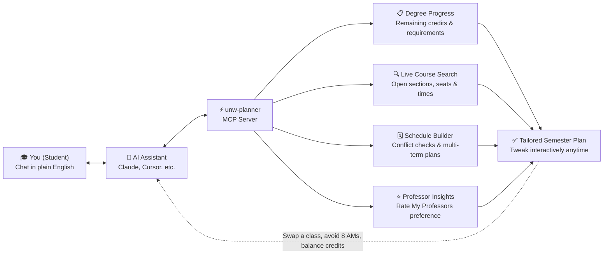

&lt;div align=&quot;center&quot;&gt;

# 🎓 Eagle Flightplan

**An AI-ready degree & schedule planner for University of Northwestern – St. Paul students.**

[](https://github.com/HenryGetz/unw-planner/actions/workflows/ci.yml)


*Ask your AI assistant what classes you still need, find open sections that fit your life, avoid time conflicts, and map out every semester to graduation.*

&lt;/div&gt;

> [!NOTE]
> **Independent Project:** `unw-planner` is built for UNW students and is not affiliated with, endorsed by, or supported by the University of Northwestern – St. Paul, Ellucian, or Rate My Professors.

---

## ✨ What It Does

Instead of clicking through half a dozen student portals, connect `unw-planner` to your favorite AI tool (like Claude Desktop or Cursor) and plan your degree in plain English:

- **Checks what you have left** — Reads your degree progress and remaining requirements automatically.
- **Finds real, open classes** — Matches your remaining credits against the live UNW course catalog and open sections.
- **Prevents time conflicts** — Builds conflict-free schedules for next semester or your entire path to graduation.
- **Factors in professor ratings** — Uses Rate My Professors scores as a gentle tie-breaker when multiple sections fit.

---

## 🧠 How Your AI Uses It



---

## 🚀 Quick Start

### 1. Install in one command

Requires **Python 3.11+** and a **UNW student account**.

```bash
pipx install git+https://github.com/HenryGetz/unw-planner.git
```

### 2. Sign in with your UNW account

Run the login setup once to connect your **UNW Microsoft account**:

```bash
unwplanner login
```

- **Local & private:** Your session stays on your own computer—credentials and session cookies are stored locally and refreshed automatically so you aren't prompted every time.
- **Two-factor friendly:** Supports your standard Microsoft phone approval (or an authenticator TOTP code if you prefer).

### 3. Connect to your AI tool

Add `unw-planner` to your AI client's MCP config (for example, Claude Desktop's `claude_desktop_config.json`):

```json
{
  "mcpServers": {
    "unw-planner": {
      "command": "unwplanner-mcp"
    }
  }
}
```

Restart your AI app, and you're ready to plan.

---

## 💬 Try Asking Your AI

| Goal | Example Prompt |
| :--- | :--- |
| **Audit check** | *"What classes do I still need to graduate, and which ones are offered this fall?"* |
| **Schedule build** | *"Build me a conflict-free 16-credit Fall schedule with no classes before 9:30 AM."* |
| **Professor match** | *"Are there multiple sections for my stats requirement? Pick the highest-rated professor."* |
| **Multi-term map** | *"Lay out every semester from now until Spring 2028 so I don't miss any prerequisites."* |
| **Quick swap** | *"Move my Tuesday afternoon class to Thursday morning and re-check for conflicts."* |

---

&lt;details&gt;
&lt;summary&gt;🛠️ Using the CLI or developing locally?&lt;/summary&gt;

Everything `unw-planner` exposes to your AI is also available from the terminal via `unwplanner --help`. Check the project's `docs/` folder for standalone CLI commands, logging details, and contributor setup.

&lt;/details&gt;
